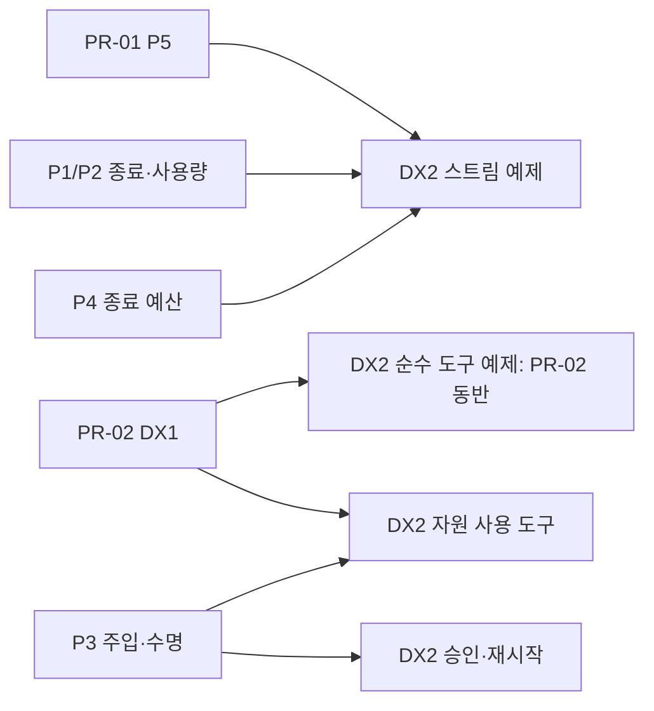

# v0.25 P5·DX1 PR 계획

작성일: 2026-10-25. 코드 기준: v0.24.0, `8d56e0df790a0ca518295545a0439b214d7b2d80`.
상태: **2026-10-26 실행 착수 — P5 사전조사, DX1 후속**. 사용자는 최신 develop에서 수정 전 실패하는 회귀를
고정하고 P5 독립 PR, 이후 DX1 별도 PR을 진행하도록 요청했다. 현재 실행 상태와 증거는 §9에 기록한다.

범위의 기준은 [v0.25 통합 계획](V0_25_PRE_INVESTIGATION.md)이다. [개발자 경험 설계](V0_25_DEVELOPER_EXPERIENCE_PROPOSAL.ko.md)는
목표 API와 후속 방향을 설명한다. 이 문서는 첫 두 PR의 변경 경계·의존성·실제 소비자·검증 기준을 고정한다.
각 PR은 구현 직전 최신 develop에서 preflight를 갱신한다. §7–8은 구현 전 조사·설계 리뷰의 역사다.

## 1. 착수 순서와 의존성

| PR | 결과 | 필수 선행 | 예상 범위와 통합 |
|---|---|---|---|
| PR-01 / P5 | 권한이 끝난 스트림의 새 조각 전달을 차단 | 없음 | S: 기존 `_astream` 전달 경계·회귀·계약 설명, 독립 PR → develop |
| PR-02 / DX1 | 중첩 Python 타입으로 도구를 작성하고 모델 결과를 JSON으로 받음 | 없음; PR-01 병합을 기술적 전제로 삼지 않음 | S–M: decorator·실제 loop 회귀·예제·마이그레이션, 독립 PR → develop |

P5는 실행 권한 결함이므로 먼저 착수한다. DX1은 별도 소스 소유자여서 독립 진행할 수 있다.
후속 P1/P2/P4가 `model_call.py`를 수정할 때 P5의 전달 경계를 유지하도록 최신 develop에 재기준화한다.
이는 공유 파일의 통합 순서이며 새 API를 기다리는 의존성이 아니다.

예정 브랜치는 `codex/v0.25-p5-stream-authority`, `codex/v0.25-dx1-typed-tools`다. 구현 착수 때 생성한다.
현재 두 PR에는 캠페인 전용 통합 브랜치가 필요하지 않다. P3·P1/P2·P4는 각각 독립 작업군을 유지한다.



화살표는 해당 예제가 새 계약을 소비하는 관계다. 기존 승인/checkpoint/control 경로는 이미 존재한다.
P8의 포함 여부는 이 그래프의 P3 자원 격리·parent authority 검사를 바꾸지 않는다.

## 2. 외부에서 확인한 문제와 채택할 답안

확인일은 2026-10-25다. 이슈의 증상 보고, maintainer의 설명, 실제 구현을 구분했다.
아래 적용 판단은 외부 사례와 우리 소스를 대조한 설계 결론이다. 외부 이슈의 모든 증상을 우리 제품의 결함으로 간주하지 않는다.

| 외부 문제와 증거 상태 | 참고할 답안 | 우리 제품에 적용할 범위·검증 |
|---|---|---|
| [Vercel AI #23507](https://github.com/vercel/ai/issues/23507), 2026-10-17, open: abort 처리 뒤 남은 이벤트가 다음 turn listener에 들어가 응답을 잃는 보고 | 이벤트 생산·전달을 원래 turn 수명에 귀속. 이슈의 turn ID/filter 제안은 미해결 제안으로 취급 | 기존 `driving`과 호출별 consumer를 유지하고 전달 경계의 authority 누락을 수정. 실제 loop에서 이전 턴 late delta가 다음 턴에 들어가지 않는 회귀 유지 |
| [Vercel core stream 구현](https://github.com/vercel/ai/blob/0a5d0e7489555e14c99ef654bd26016e2a4e26a4/packages/ai/src/generate-text/stream-text.ts#L1931), 해당 파일의 2026-10-22 revision: `reader.read()` 뒤 abort를 다시 검사한 다음 enqueue | 작업을 기다리기 전 검사에 더해 **전달 직전 재검사**, reader 정리와 사용자 결과 종결 분리 | P5의 normal/terminal/remainder 모든 조각에 기존 authority fence 적용. 이 core 코드를 #23507 Harness 문제의 해결 커밋으로 표현하지 않음 |
| [Vercel #7628](https://github.com/vercel/ai/issues/7628), open: abort 뒤 token usage를 얻기 어려움. [2026-01-21 maintainer 답변](https://github.com/vercel/ai/issues/7628#issuecomment-3777983577)은 provider가 finish 없는 스트림의 usage를 보통 보내지 않는다고 설명 | 확인된 증거와 미보고를 구분; drain은 제한된 회수 기회 | P1/P2의 unknown/partial 유지. P5에서 usage 추정·청구 계산·무한 drain을 추가하지 않음 |
| [LangChain #34770](https://github.com/langchain-ai/langchain/issues/34770), 2026-01-16, open: 입력 검증 뒤 `model_dump()`가 context까지 직렬화해 비용·부작용 발생 | 검증된 필드 값을 직접 전달. [현재 소스](https://github.com/langchain-ai/langchain/blob/8d34066f4249578bda025eb80c0c146e89016544/libs/core/langchain_core/tools/base.py#L834)도 값은 `getattr`로 얻지만 순회 전 dump가 남아 있음 | DX1은 이미 수집한 함수 필드명으로 `getattr`만 사용. 입력 serializer **0회** 회귀 추가. 관련 [PR #39585](https://github.com/langchain-ai/langchain/pull/39585)는 closed·미병합이므로 채택된 해결책으로 세지 않음 |
| [LangChain #32953](https://github.com/langchain-ai/langchain/issues/32953), closed: 모델 반환이 문자열로 바뀌어 callback에서 필드 사용이 어려움; 사용자가 content/artifact 우회를 확인 | 구조화 결과를 데이터로 보존하고 실패를 명시. [현재 문자열 fallback](https://github.com/langchain-ai/langchain/blob/8d34066f4249578bda025eb80c0c146e89016544/libs/core/langchain_core/tools/base.py#L1471)의 비용도 확인 | 최상위 BaseModel을 JSON으로 변환. 실패에 `str()`/`repr()` fallback을 두지 않고 기존 tool failure로 전달. 새 artifact 채널은 추가하지 않음 |
| [Pydantic AI #1525](https://github.com/pydantic/pydantic-ai/issues/1525): 전체 실행 결과를 도구에서 반환해 내부 span 직렬화까지 도달. [#1545](https://github.com/pydantic/pydantic-ai/pull/1545)는 2025-04-18 병합, span 대신 traceparent 보관 | 실행 객체와 공개 결과 데이터의 경계를 정함. maintainer는 도구에 `result.output` 반환을 안내 | 임의 실행 객체·host 자원 트리를 자동 지원하지 않음. DX1은 명시적으로 반환한 최상위 BaseModel만 변환하고 기존 portable 검사 유지 |
| [Pydantic 2.6 직렬화 계약](https://docs.pydantic.dev/2.6/concepts/serialization/), 현재 의존성 하한과 일치. RootModel·custom model serializer는 비-dict 반환 가능 | Python 필드 접근과 JSON dump를 구분하고 실제 dump 형태로 envelope 선택. [Pydantic AI 구현](https://github.com/pydantic/pydantic-ai/blob/4ee11516b5be6b767654304ec8fe346b81369597/pydantic_ai_slim/pydantic_ai/messages.py#L2153)도 JSON 변환 뒤 형태를 검사 | dict는 content, 그 외 portable 값은 기존 result 슬롯. `Field(exclude=True)`·SecretStr 등 모델 자체 직렬화 정책 유지; return annotation 기반 필드 투영은 약속하지 않음 |

[Python 3.11 cancellation 계약](https://docs.python.org/3.11/library/asyncio-task.html#task-cancellation)도 P5 판단의 기반이다.
취소 요청 후 coroutine의 정리가 이어질 수 있다. 현재 bounded close/grace와 원래 오류를 보존하고 전달 권한을 별도로 검사한다.
[Vercel의 stopping streams 문서](https://ai-sdk.dev/docs/advanced/stopping-streams)는 abort와 `resume: true`의 충돌을 명시한다.
후속 웹 어댑터에서는 요청 단절 취소와 durable 작업의 passive 구독 종료를 각각 설계한다. 이 어댑터는 이번 두 PR의 범위에 넣지 않는다.

| 구현 선택지 | 총비용 판단 | 결정 |
|---|---|---|
| 기존 authority helper·`driving`·ingress normalizer 재사용 | 수정 지점이 전달 소유자 한 곳이며 기존 취소/Unicode/복구 계약 재사용 | P5 채택 |
| 새 turn-ID event bus·provider 강제 재시작 | wire·consumer·수명 정책을 늘림; 현재 재현의 필수 해결 수단이 아님 | 후속 소비 요구가 생길 때 평가 |
| 기존 Pydantic 검증 + 필드 접근 + 명시적 JSON dump | 의존성 추가 없이 입력/출력 경계를 분리; 실제 loop까지 검증 가능 | DX1 채택 |
| 전역 TypeAdapter[Any]·임의 객체 serializer·도구 프레임워크 교체 | 지원 타입·실행 객체 유출·envelope·호환성 범위를 크게 늘림 | 이번 범위에서 제외 |

## 3. PR-01 — P5 스트림 전달 권한 검사

**문제와 목표.** 직접 `ModelCallRunner` consumer는 revoke 이후 잔여 U+FFFD와 일반 delta를 받을 수 있다.
동일 authority를 공유하는 각 조각의 전달 경계가 revoke를 확인하면 append·consumer 호출을 거부한다.
일반 완료와 권한이 유효한 user cancel은 현재 Unicode·drain 의미를 유지한다.

| 변경 대상 | PR에서 수행할 일 |
|---|---|
| [model_call.py](../src/monoid_agent_kernel/model_call.py) `_astream` | normal/terminal-normalized/remainder의 조각 전달을 작은 공통 경계로 모아 authority 검사; 기존 helper 활용 |
| 같은 함수의 `driving`, `drain_rest`, retry marking, exception/finally | 현재 수명·오류 우선순위·bounded cleanup을 보존하는지 대조. 필요한 전달 경계 수정만 수행 |
| [test_model_call_runner.py](../tests/test_model_call_runner.py) | 직접 runner의 새 반례를 결정적인 event/callback 순서로 고정; 다음 턴 loop 회귀 재사용 |
| [test_model_stream_observer.py](../tests/test_model_stream_observer.py), [test_authority.py](../tests/test_authority.py) | 기존 observer/fence 계약 검증. 확인된 공백이 있을 때만 테스트 추가 |
| 계약/릴리스 문서 | [CONTRACTS.md](CONTRACTS.md)의 관련 보장과 CHANGELOG에 증상·수정 경계·한계 반영; 이번 계획의 구현 증거 갱신 |

`ModelStreamIngressNormalizer.normalize(TurnComplete)`는 보류 조각과 terminal을 함께 반환할 수 있다.
한 raw chunk당 검사 한 번으로 끝내지 않고 각 정규화된 조각을 검사한다. 첫 조각의 consumer가 revoke하면 뒤 조각은 전달하지 않는다.
현재 `_marking_consumer`는 consumer 진입 전에 delivered를 표시한다. consumer가 실패해도 재시도를 열지 않는 이 순서를 유지한다.

임의 callback을 authority lock 안에서 실행하지 않는다. 기존 external-call fence의 전후 검사와 짧은 local mutation 경계를 검토한다.
이미 허용되어 진입한 callback의 효과를 소급 취소할 수는 없다. acceptance는 명시적으로 제어한 revoke→다음 게시 순서와
callback 중 revoke→후속 게시 차단에 둔다. `lease_lost`가 최종 종료 원인을 유지해야 한다.

**제외 범위:** P1/P2의 receipt·사용량 schema, P4 clock 전환, P8 child 정책, provider 강제 kill,
새 stream protocol, 새 권한 타입, 정상 cancel의 Unicode flush 제거, drain 기본값 변경.

### P5 수용 행렬

| ID | 입력/경합 | 구현 후 기대값과 반증 기준 |
|---|---|---|
| P5-01 | `x + high surrogate` → revoke → stall/EOF/provider cancel, drain=0/5 | 6개 모두 texts=`['x']`, `lease_lost`, settlement=0. 현재 코드는 추가 U+FFFD를 전달하므로 신규 회귀가 실패해야 함 |
| P5-02 | `x` → revoke → `late` → stall, drain=0/5 | texts=`['x']`, `late` 미전달. 현재 코드 2개 조합 모두 실패해야 함 |
| P5-03 | text/reasoning/tool-args의 보류 문자를 terminal이 함께 flush; 첫 consumer에서 revoke | 첫 허용 조각 뒤 나머지 조각·terminal 미전달. raw chunk당 1회 guard 구현을 검출 |
| P5-04 | authority 유효 또는 미주입; 정상 EOF/terminal과 lone surrogate·채널 교차 | 현재 정규화된 텍스트·순서·완성 turn 동일. flush를 통째로 버리는 수정은 실패해야 함 |
| P5-05 | user cancel→정상 drain terminal; cancel/revoke 순서 교차·drain 도중 revoke | 권한 유효 취소는 기존 보류 문자·usage 정산 보존. revoke는 이후 전달·settlement 차단 및 lease_lost 우선 |
| P5-06 | consumer 예외, provider 예외, close가 cancellation을 억제, abandon 뒤 late chunk | 원래 consumer 예외 타입·retry window 보존, 기존 grace 이내 복귀, callback 정리, 다음 턴에 토큰 없음 |
| P5-07 | durable settle/receipt subscriber 중 revoke | 기존 canonical sink·observer·sidecar의 추가 게시 차단 유지. 직접 consumer 회귀를 이 테스트로 대체하지 않음 |

최초 회귀는 standalone runner로 작성한다. loop observer의 기존 authority guard가 같은 결함을 가릴 수 있다.
`test_one_turns_tokens_cannot_arrive_in_the_next_turns_stream`은 두 runner와 실제 QueueEventSink의 재바인딩을 검증한다.
실제 AgentLoop 통합은 기존 `test_lease_loss_during_first_stream_push_stops_remaining_writers`와
`test_run_stream_and_passive_observer_receive_their_distinct_chunk_sets`로 확인한다.
의도한 경합을 event/callback으로 동기화하고 임의 sleep에 성공 여부를 의존하지 않는다.

**완료 기준:** P5-01/02가 동일 base에서 red, 수정 후 green; P5-03–07과 관련 기존 회귀 통과;
최종 head 독립 리뷰·PR CI 통과. schema·공개 API·의존성 변경은 0이어야 한다.
롤백 시 데이터 변환은 필요 없지만 기존 출력 결함이 돌아온다. 릴리스 판정에는 이를 결함 재도입으로 기록한다.

## 4. PR-02 — DX1 typed 도구 입력과 결과

**문제와 목표.** 현재 decorator는 검증한 `Customer`를 dict로 바꿔 handler에 전달하고,
반환한 BaseModel은 portable JSON 경계에서 거부된다. 개발자가 도메인 타입을 그대로 사용하고 기존 tool observation을 받게 한다.

| 변경 대상 | PR에서 수행할 일 |
|---|---|
| [tools/decorator.py](../src/monoid_agent_kernel/tools/decorator.py) | 기존 검증 모델·필드 목록 재사용, `getattr`로 kwargs 생성, 최상위 BaseModel JSON 변환과 실패 분류 |
| [tools/base.py](../src/monoid_agent_kernel/tools/base.py) | 기존 portable 검사·ToolResult envelope를 기준으로 사용. 전역 정규화 범위는 확대하지 않음 |
| [test_tool_decorator.py](../tests/test_tool_decorator.py), [test_tool_result_envelope.py](../tests/test_tool_result_envelope.py) | sync/async 입력 타입·serializer 부작용·출력 형태·기존 관찰 형식 회귀 |
| [test_loop.py](../tests/test_loop.py), [test_async_tools.py](../tests/test_async_tools.py) | 실제 `AgentLoop.from_tools`와 FakeModelAdapter에서 호출→observation→다음 모델 호출 확인 |
| [custom_tool_quickstart.py](../examples/custom_tool_quickstart.py), [EMBEDDING.md](EMBEDDING.md) | 순수 typed 도구 예제와 목표 observation을 연결. P3 자원 주입은 이 PR에서 사용하지 않음 |
| [COMPATIBILITY.md](COMPATIBILITY.md), CHANGELOG | 모델 annotation에 dict를 기대하던 handler의 마이그레이션·기존 envelope 유지 기록 |

검증 오류는 현재 `invalid_tool_args`로 반환한다. 입력 kwargs 생성에 serializer를 호출하지 않는다.
출력에서는 실제 BaseModel 인스턴스를 `model_dump(mode="json")`으로 변환한다. dict 결과는 `ToolResult.content`,
그 외 portable 결과는 `content={"result": value}`에 두어 기존 scalar envelope와 맞춘다.
RootModel 여부만으로 분기하면 scalar를 반환하는 custom model serializer를 놓친다.

직렬화 단계의 일반 실패는 기존 `ToolExecutionError(error_code="tool_result_unportable")` 경로로 분류한다.
loop의 기존 변환을 거친 observation은 `ok=False`, `category="tool"`, `retryable=True`다. 이 retryable은 모델에 주는
재시도 가능성 정보이며 자동 재시도를 실행하는 설정이 아니다. 실패 코드만 복제한 기본 ToolResult로 이 의미를 바꾸지 않는다.
모델에 보이는 오류 문구는 짧고 고정된 진단으로 둔다. raw serializer 예외·모델 repr·`str()` fallback을 노출하지 않는다.
PydanticSerializationError의 원인에 기존 RunCancelled·RunTimeout·TurnInterrupted·WriteAuthorityRevoked 또는
asyncio.CancelledError가 있으면 decorator에서 원래 예외를 재발생한다. 일반 serializer 예외만 직렬화 실패로 변환한다.
그 이후 loop는 현재 취소 분류를 유지한다. handler 자체가 발생시킨 CancelledError는 `tool_handler_cancelled`,
retryable=True인 실패 observation이고 run은 계속할 수 있다. host가 run task를 취소하거나 run boundary가
cancel/timeout을 감지한 경우에는 실행 종료 경로를 유지한다. 두 경우를 하나의 기대값으로 묶지 않는다.
직접 발생한 예외와 Pydantic wrapper의 cause 안 예외를 모두 검증하며 전역 예외 처리 정책은 확장하지 않는다.
명시적 ToolResult의 오류·재시도 의미는 그대로 유지한다.

자동 변환은 최상위 모델에 한정한다. dict나 명시적 ToolResult.content 내부의 BaseModel을 재귀적으로 허용하지 않는다.
모델 자체의 표준 exclude/SecretStr 직렬화 정책을 존중한다. 반환 annotation이 실제 subclass의 필드를 투영하거나
감춰 준다는 보장은 추가하지 않는다. 도구 작성자는 모델에 공개할 반환 데이터 타입을 선택한다.

**제외 범위:** P3 ctx/resource 주입, return annotation 검증·출력 schema, dataclass/임의 객체 지원,
전역 serializer, 새 artifact 채널, annotation 해석 실패 정책 변경, Pydantic 의존성 상향, decorator signature 개편.

### 개발자가 쓰는 목표 API

아래 코드는 **DX1 구현 후 목표**다. API 이름은 현재 존재하며, 중첩 인자·모델 반환 동작이 이번 PR에서 바뀐다.
P3 신규 API 없이 재현할 수 있는 최소 소비 예제다.

```python
from pydantic import BaseModel
from monoid_agent_kernel import tool

class Customer(BaseModel):
    name: str

class ReportDraft(BaseModel):
    customer: Customer
    title: str

class ReportSummary(BaseModel):
    customer: str
    title: str

@tool
def summarize_report(draft: ReportDraft) -> ReportSummary:
    return ReportSummary(customer=draft.customer.name, title=draft.title)
```

기존 `AgentLoop.from_tools(spec, adapter, tools=[summarize_report])`에 연결한다.
모델이 `{"draft":{"customer":{"name":"민수"},"title":"주간 보고"}}`를 호출 인자로 보내면 다음 observation을 얻는다.

```json
{"ok": true, "result": {"customer": "민수", "title": "주간 보고"}}
```

현재 버전에서는 입력을 dict로 선언한 뒤 handler 안에서 `ReportDraft.model_validate()`를 호출하고,
결과를 `model_dump(mode="json")`으로 반환해야 같은 흐름을 구성할 수 있다. DX1은 이 반복 코드를 제거한다.
모델 annotation을 유지하며 `draft["title"]`처럼 쓰던 handler는 속성 접근으로 바꾸거나 dict annotation을 선택한다.

### DX1 수용 행렬

| ID | 실제 계약 | 구현 후 기대값과 반증 기준 |
|---|---|---|
| DX1-01 | sync/async handler의 BaseModel, 중첩·list/dict 안 모델, enum, 기본값 | 선언 타입과 검증된 값 전달. 기존 코드의 모델 입력 회귀는 수정 전 실패해야 함 |
| DX1-02 | 입력 모델에 부작용/실패를 가진 serializer 설치 | 입력 처리의 serializer 호출 **0회**. dump 후 getattr 방식도 실패해야 함 |
| DX1-03 | invalid args와 context 주입, 기존 입력 schema | invalid_tool_args 및 handler 미실행; ctx 분리·schema·기존 dict/scalar 입력 보존 |
| DX1-04 | datetime/UUID/enum의 모델 결과, dict RootModel, list/scalar RootModel, 비-dict custom serializer | JSON 모드 변환, 실제 결과 형태에 따른 기존 envelope. top-level 모델 출력은 수정 전 실패해야 함 |
| DX1-05 | dict·scalar·명시적 ToolResult와 `ok/error/result` 필드를 가진 도메인 모델 | 도메인 필드는 content 안에 남고 최상위 성공/오류로 오해하지 않음. 기존 envelope 동일 |
| DX1-06 | unsupported 값/custom serializer 일반 실패; dict/ToolResult 안 모델 | 기존 portable tool failure의 code/category/retryable 유지, raw 예외·repr 미노출, 성공 문자열 fallback 없음. 임의 재귀 변환 없음 |
| DX1-07 | Field exclude·SecretStr·실제 subclass 인스턴스 | 모델 자체 직렬화 설정 준수. 반환 annotation으로 새 필드 필터링을 만들지 않음 |
| DX1-08 | 실제 loop가 typed 도구 호출 후 observation을 다음 모델 요청으로 전달 | handler의 타입, 성공/실패 observation, 성공 tool.call.finished·실패 tool.call.failed, 다음 요청 내용을 함께 확인; run 종료만 검사하지 않음 |
| DX1-09 | serializer가 cancel/timeout/turn interrupt/lease loss/async cancellation을 발생시킴 | decorator는 wrapper의 cause에 있는 원래 예외를 재발생. RunCancelled/RunTimeout/TurnInterrupted/authority 종료 계약 보존; serializer 내부 CancelledError는 기존 loop에서 tool_handler_cancelled·retryable=True 관찰과 다음 모델 호출로 연결 |
| DX1-10 | host가 실행 task를 cancel 또는 run cancellation/deadline 도달 | host/run 종료를 tool_handler_cancelled나 tool_result_unportable로 바꾸지 않음; 다음 모델 호출 없음. 기존 handler-local 취소와 대조 |

**호환성:** 기존 ToolResult/observation wire를 재사용한다. 이 변경만으로 schema/codec version을 올리지 않는다.
annotation과 다른 dict 입력을 기대한 handler에는 동작 변경 안내가 필요하다. 새 typed 도구를 배포한 소비자가 구버전으로
되돌릴 때에는 dict 수동 검증/JSON 반환 방식도 함께 되돌려야 한다. 영속 데이터 마이그레이션은 요구하지 않는다.

**완료 기준:** DX1-01/02/04의 신규 회귀가 수정 전 red, 수정 후 행렬 통과; 실제 loop의 성공·실패 관찰 확인;
지원 Python 3.11/3.12와 선언된 Pydantic 하한 2.6 및 현재 검증 버전의 대표 경로 확인;
설치 wheel의 순수 예제·최종 head 독립 리뷰·PR CI 통과. 하한 검증은 격리 환경에서 수행하고 공유 .venv를 downgrade하지 않는다.

## 5. 후속 작업군의 PR 분할 기준

첫 두 PR 뒤의 식별자는 계획 단위다. 실제 PR 수는 최신 base에서 유효한 중간 상태와 리뷰 크기를 확인해 확정한다.

| 후보 PR 단위 | 변경 경계 | 필수 선행과 검증 |
|---|---|---|
| G2 / P3 내부 수명 기반 | identity key·activation registry·원래 call lease·guarded workspace, 내부 fixture의 첫 수직 경로 | 독립 시작. retained view/context·부분 초기화·child/fork·parent revoke·park-release를 검증; 불완전한 공개 주입 경로는 노출하지 않음 |
| G2 / P3 공개 연결·소비 경로 | 선택적 Protocol/helper, keyword-only 주입, bootstrap·restore 연결, 보고서 도구 예제 | 내부 수명 기반. DX1 예제를 쓰는 경우에만 PR-02 의존; release/arelease cleanup 실패·discard·새 activation 복구까지 완료 후 공개 |
| G1 / P1·P2 reader 준비 | 공동 필드/codec 설계, 구형·신형 reader와 fixture, 생산 writer는 기존 형식 유지 | 독립 시작. old/new fixture, strict reader 경계, replay identity 검증 |
| G1 / P1·P2 생산·전달 | provider ingress→attempt/receipt/exception→writer·ledger→loop/hosting/Studio/OTel | reader 준비. sparse 0/unknown, retry·drain, unknown paid dispatch, 복구 중복 집계, 혼합 버전·rollback 검증. reader의 새 사실 부재는 명시적으로 표현 |
| G3 / P4 시간 제어 정렬 | run/call/drain/sync wait를 monotonic cutoff로 정렬 | 독립 시작. wall-clock jump·epoch 입력 변환·deadline 우선순위 검증 |
| G3 / P4 snapshot·소비 연결 | 호출별 registry, 공개 조회, RunStream 동일 기준 | 시간 제어 정렬. active 없음·drain 전 None·동시 호출·변경된 설정·grace 상한 검증 |
| G7 / 남은 DX2 조합 | 기능 PR에 동반하지 못한 스트림·승인/재시작 예제와 wheel 수용 | 사용한 계약만 선행. 공개 API 밖 접근 없이 성공·실패·재개를 검증; reference 안정성 등급 유지 |
| 릴리스 마감 | version/changelog·compatibility·전체 CI·wheel/install·audit | 필수 P1–P5+DX1+DX2 완료. P8 포함 여부 기록; 준비되지 않은 P8·독립 유지보수는 마감을 대기시키지 않음 |

P3 내부 기반을 별도 PR로 완결하기 어려우면 두 단위를 하나의 리뷰 가능한 수직 PR로 합친다.
G1은 새 writer의 모든 소비자가 준비된 상태로 전환한다. 큰 생산·전달 변경은 완결된 adapter/reader 경계에서 추가 분할한다.
새 형식의 record를 쓰기 시작한 이후 rollback에는 새 형식 reader 유지 또는 검증된 데이터 전환이 필요하다.

## 6. 구현 단계의 검증·운영·비용 기준

| 단계 | 수행할 확인 |
|---|---|
| PR 착수 preflight | 최신 develop SHA·clean/user 변경 상태·소스 import 경로·현재 AGENTS·실제 호출자·upstream 상태 재확인. 이 계획과의 차이를 기록 |
| 최소 반례 | 각 PR의 수정 전 실패 조건을 먼저 테스트로 고정. 출력/입력 계약 소유 층에서 재현하고 실제 loop 소비 연결 |
| 로컬 검증 | 공통 pytest prefix + 변경된 소유 모듈과 관련 기존 회귀. lint·공개 표면·호환성 검사 중 영향받는 항목 실행 |
| CI | 현재 profile resolver 기준 두 PR은 core. L1 push, L2 Ready checkpoint; 실제 durable/service 경로를 바꾸면 profile 재선정 |
| 리뷰·통합 | 독립 reviewer가 실패 경로·소비자·호환성·수정 전 red를 검토. 최종 head 증거를 확인하고 merge commit으로 develop 통합 |
| 릴리스 | 마지막 필수 작업 뒤 combined/service·전체 compatibility·wheel/install·release audit. source baseline과 배포 artifact 검증을 구분 |

모든 pytest 명령의 prefix는 `pytest -q -n auto --dist=worksteal --timeout=120 --timeout-method=thread`다.
P5는 `test_model_call_runner.py`의 새 회귀와 §7의 기존 Unicode/retry/drain/다음 턴 선택을 함께 실행한다.
DX1은 `test_tool_decorator.py`, `test_tool_result_envelope.py`, 새 실제 loop sync/async node,
`test_public_surface.py`, `test_compatibility_ledger.py`와 wheel 예제를 실행한다. 미작성 test node 이름을 현재 존재하는 명령으로 기재하지 않는다.

PR별 기록은 base/final SHA, source·test·docs diff, 실행한 명령/결과, 미실행 항목과 이유, 리뷰 반영 및 남은 소비자 이전을 포함한다.
S/M은 문서·회귀·호환성·리뷰를 포함한 상대 비용이다. functional diff 약 2,000줄 soft limit을 넘기기 전에 분할을 재검토한다.
이미 유효한 결과를 같은 코드에서 반복하지 않고 새로운 변경·실패·미해결 위험이 있는 범위만 추가 검증한다.

계획 작성 당시 역할: 총괄은 범위·통합·증거를 정리하고, 외부 연구 담당은 DX1 사례를 read-only로 확인했다.
독립 reviewer는 초안 작성과 분리해 설계를 검토한다. 구현 담당은 후속 구현 요청 때 배정한다.
2026-10-25 계획 작성에서는 source/test/example 구현, dependency 설치·상향, branch/commit/PR 생성, CSP 수정·배포를 수행하지 않았다.

## 7. 현재 실행한 증거

환경: `.venv/Scripts/python.exe`, Python 3.11.9, Pydantic 2.13.4. 코드 HEAD는 문서 상단과 같다.
이전 조사에서 실제 AgentLoop의 typed 입력 실패와 모델 출력 `tool_result_unportable`를 확인했고,
offline 예제 4개 성공 및 관련 **146 passed / 5 skipped**를 기록했다. 상세 명령은 [개발자 경험 설계 §10](V0_25_DEVELOPER_EXPERIENCE_PROPOSAL.ko.md)에 있다.

### 추가 P5 진단: 구현 파일 변경 없이 기존 helper로 재현

아래 Python은 저장소 루트에서 `.venv/Scripts/python.exe -`로 실행했다. private helper는 조사에만 사용하며 구현 PR에서 독립 회귀로 고정한다.

```python
import asyncio
import runpy
import sys

sys.path.insert(0, "tests")
n = runpy.run_path("tests/test_model_call_runner.py")
for budget in (0.0, 5.0):
    for ending in ("stalls", "finished", "provider_cancel"):
        authority = n["ActivationWriteAuthority"]()
        steps = [n["TextDelta"]("x\ud83d"), authority.revoke]
        if ending == "stalls":
            stream = n["_DrainStream"](*steps, n["_STALL"])
        elif ending == "provider_cancel":
            stream = n["_NoCloseStream"](*steps, asyncio.CancelledError())
        else:
            stream = n["_NoCloseStream"](*steps)
        out = n["_drain_call"](stream, drain_s=budget, authority=authority, timeout_s=5.0)
        print(budget, ending, type(out.error).__name__,
              getattr(out.error, "interruption_cause", None),
              [ascii(x) for x in out.texts], len(out.settled))

for budget in (0.0, 5.0):
    authority = n["ActivationWriteAuthority"]()
    stream = n["_DrainStream"](
        n["TextDelta"]("x"), authority.revoke, n["TextDelta"]("late"), n["_STALL"]
    )
    out = n["_drain_call"](stream, drain_s=budget, authority=authority, timeout_s=5.0)
    print(budget, "ordinary", type(out.error).__name__,
          [ascii(x) for x in out.texts], len(out.settled))
```

앞의 6개 조합은 texts=`['x', '\ufffd']`, 뒤의 2개는 `['x', 'late']`였다.
8개 모두 error는 `WriteAuthorityRevoked`, settled는 0이다. 앞의 6개에서는 cause=`lease_lost`도 확인했다.
관측 범위는 직접 runner consumer다. CSP 운영 환경과 외부 callback의 실제 효과는 이 probe에서 확인하지 않았다.

### 기존 회귀의 기준선

```powershell
$env:PYTEST_XDIST_AUTO_NUM_WORKERS = '4'
& ./.venv/Scripts/python.exe -m pytest -q -n auto --dist=worksteal --timeout=120 --timeout-method=thread tests/test_tool_decorator.py tests/test_tool_result_envelope.py tests/test_authority.py tests/test_model_stream_observer.py tests/test_model_call_runner.py::test_stream_normalizes_each_visible_chunk_and_the_assembled_turn tests/test_model_call_runner.py::test_stream_preserves_surrogate_pairs_across_interleaved_logical_channels tests/test_model_call_runner.py::test_stream_flushes_lone_surrogates_in_original_global_order tests/test_model_call_runner.py::test_one_turns_tokens_cannot_arrive_in_the_next_turns_stream tests/test_model_call_runner.py::test_a_delivered_chunk_closes_the_retry_window tests/test_model_call_runner.py::test_delivery_is_marked_before_the_consumer_runs tests/test_model_call_runner.py::test_a_consumer_exception_is_not_retried_and_keeps_its_type tests/test_model_call_runner.py::test_lease_loss_is_also_checked_at_every_drained_chunk tests/test_model_call_runner.py::test_a_user_cancel_drain_settles_a_held_back_lone_surrogate tests/test_model_call_runner.py::test_a_lease_lost_in_the_tick_a_user_cancel_began_the_drain_settles_nothing tests/test_model_call_runner.py::test_every_exit_from_a_drain_enabled_stream_leaves_no_callback_behind
```

결과: **76 passed / 10.75s / exit 0**. 새 수정과 신규 테스트는 구현하지 않았다.
전체 suite·실제 서비스·새 API·Pydantic 하한 환경·wheel의 새 예제는 미검증이며 구현 PR과 릴리스의 수용 기준으로 남긴다.

### DX1 오류 경계의 추가 진단

Pydantic 2.13.4에서 `@model_serializer`가 ValueError, RunCancelled, RunTimeout, TurnInterrupted,
WriteAuthorityRevoked, asyncio.CancelledError를 각각 발생시키도록 read-only probe를 실행했다.
6개 모두 `PydanticSerializationError`로 감싸졌고 `__cause__`에 원래 예외가 남았다.
DX1-09/10은 이 관측과 기존 loop의 host/callee 취소 분류를 반영한 구현 단계 회귀다.
선언 하한 2.6에서의 같은 경계는 구현 PR에서 검증한다.
현재 `tools/base.py`의 `tool_result_unportable`는 ToolExecutionError이고, loop는 retryable=True·category=tool로
실패 observation을 만든다. `loop.py::_finalize_tool_call`은 성공/실패에 따라 finished/failed 이벤트를 각각 기록한다.

독립 리뷰의 취소 분류 지적을 확인하며 다음 두 기존 대조 테스트를 추가 실행했다.

```powershell
$env:PYTEST_XDIST_AUTO_NUM_WORKERS = '4'
& ./.venv/Scripts/python.exe -m pytest -q -n auto --dist=worksteal --timeout=120 --timeout-method=thread tests/test_async_tools.py::test_tool_local_cancelled_error_becomes_failed_observation tests/test_async_tools.py::test_host_cancelling_the_run_task_is_not_reported_as_a_tool_failure
```

결과: **2 passed / 3.31s / exit 0**. Pydantic serializer를 쓰는 새 회귀는 구현 단계에 작성한다.

## 8. 통합 설계 검토 기록

초안 작성에 참여하지 않은 reviewer에게 사용자 요청·현재 소스·계획 문서·실행 증거를 전달해 read-only로 검토했다.
이전 제안의 리뷰는 [API 설계 §11](V0_25_DEVELOPER_EXPERIENCE_PROPOSAL.ko.md)에 보존하고 이번 검토와 구분한다.

- 확인된 설계 지적: serializer 내부의 asyncio.CancelledError와 host가 run task에 전달한 취소를 같은 기대값으로 묶으면
  기존 loop의 handler-local `tool_handler_cancelled` 계약과 충돌한다.
- 반영: §4의 decorator 원인 예외 재발생과 loop 분류를 구분하고 DX1-09/10에 서로 다른 observation/종료 기대값을 고정했다.
  기존 두 대조 테스트도 위 명령으로 확인했다. 전역 취소 정책 변경은 추가하지 않았다.
- 보완본 독립 리뷰 판정: **ready — 계획 범위**. P2 지적 1건 해소, 미해결 P0–P3 없음.
  reviewer는 serializer 오류의 원인 CancelledError를 재발생한 실제 AgentLoop probe에서 completed,
  tool_handler_cancelled, retryable=True를 확인했다. P5 전달 경계와 외부 고정 revision도 별도로 대조했다.
- 문서 검증: 4개 문서의 로컬 링크·앵커·공백 검사 통과, Python 예시 7개 AST 검사 통과.
  AST 검사는 신규 API의 import/실행 검증을 의미하지 않는다. source/test/example 변경은 없다.

reviewer가 확인한 candidate SHA256은 다음과 같다. 그 뒤의 PR 계획 변경은 이 검토 결과 기록뿐이다.

| 문서 | SHA256 |
|---|---|
| 통합 계획 | `4FACF8598089748AAAEA3E9DA3EA9333F310AC3B29127100EEA473D40163ED2C` |
| PR 계획 | `9610AA51DD29FCF49CBDC10E6A80FBF38B09E65398C4199D1A05B1A9B74F267F` |
| API 설계 | `B4B50ADBA765C97B15528D67D5CAED214D25E2A293D4BFCBDB1C9593FB2AEF08` |
| docs README | `8FE2ACBDD77010BF3A28FFF726F32B33D8F6C09DB0C0D8DD5DEE93DCC219B323` |

검토 범위는 계획이다. 신규 회귀의 수정 전/후 결과, 구현 최종 head의 리뷰·CI, 하한 환경·wheel·서비스·릴리스 검증은
각 구현 PR과 마감 단계에 남는다. reviewer의 동일 취소 대조 테스트 2개 재실행은 검증 범위를 추가로 늘린 것으로 계산하지 않는다.

## 9. 실행 기록 — 2026-10-26

사용자 요청에 따라 P5 → DX1을 각각 독립 PR로 진행한다. 총괄·현재 소스 조사·구현은 부모 에이전트가 담당하고,
독립 reviewer는 계획/PR preflight와 코드 검토를 수행한다. P5는 권한 경계의 A등급으로 코드 reviewer 두 명,
DX1은 typed 도구 B등급으로 한 명을 배정한다. 공유 소스 수정과 테스트 runner 사용은 부모가 순서를 관리한다.
현재 승인 범위는 구현·검증·PR·develop 통합이며 버전 릴리스·배포·CSP 변경은 별도 후속이다.

### P5 PR preflight

- 최신 base: `git fetch origin develop main` 후 `origin/develop=76a15101c7f2bfa0b56a3926365407d3c498642d`.
  기존 조사 코드 `8d56e0df790a0ca518295545a0439b214d7b2d80`와 tree 차이 0. 기존 사용자 작업 폴더를 보존하고
  `codex/v0.25-p5-stream-authority` worktree를 만들었다. 이전 계획 문서를 이 PR의 추적 가능한 근거로 포함한다.
- 필요성·생산자·소비자: `astream_turn` → ingress normalizer → `_astream` normal/remainder append·delta_consumer.
  standalone consumer는 loop observer의 별도 fence 없이 사용된다. authority는 호출 전에 이미 동기적으로 조회 가능하다.
  `_publish`·drain fold에는 검사가 있지만 일반 전달과 remainder에는 없다. §7의 8개 probe를 회귀 테스트로 고정한다.
- 최소 수정: 기존 `_assert_write_authority`를 재사용하는 공통 조각 전달 helper. append 직전 및 임의 callback 전후를
  검사하고 정상 Unicode 순서·`driving`·retry marking·기존 user-cancel drain을 유지한다. callback 동안 lock을 잡지 않는다.
  terminal이 내놓는 여러 조각 사이 consumer revoke를 별도 회귀로 고정한다. provider/normalizer·authority primitive는 변경하지 않는다.
- 대안·부채: provider kill·새 turn ID/protocol·queue 교체는 이 동기적 전달 누락에 필요하지 않다.
  이미 진입한 callback의 외부 효과는 기존 계약대로 되돌리지 않는다. 다른 P1/P2/P4 동작과 schema는 후속 소유자에게 유지한다.
- 현재 계약·검증: `CONTRACTS.md`의 per-callback authority 규칙, `_marking_consumer`의 전달 전 retry 표시,
  direct-runner Unicode·drain·QueueEventSink의 다음 턴, 실제 AgentLoop observer 테스트를 대조했다. 신규 P5-01/02/03의 red → 최소 수정 → green,
  관련 기존 회귀, ruff, 공개 표면·호환성, 코드 리뷰 두 명과 최종 head core CI를 완료 기준으로 삼는다.
- 환경: Python 3.11.9 / Pydantic 2.13.4, import가 이 worktree `src`를 가리킴을 확인했다.
  기존 `.venv`를 재사용하고 제품 의존성은 변경하지 않는다. 테스트 worker는 4개로 제한한다.
- CI: `tools/v023_ci.py validate-lock` 성공; `resolve-profile --head-ref codex/v0.25-p5-stream-authority --labels-json '[]'`
  결과 core, 기존 lock digest 유지. durable/service 구현 변경은 없으므로 개별 PR에 서비스 profile을 추가하지 않는다.
- 비용: 최초 S 범위를 유지한다. 기능 코드 수십 줄, 기존 테스트 파일의 반례 추가와 짧은 계약/CHANGELOG 수정을 예상한다.
  통합 계획 3개·색인 편입은 기존 조사 결과의 추적 비용이다. 별도 기능·프레임워크·버전 범프를 추가하지 않는다.

2026-10-27 재개 시 origin/develop을 다시 fetch했고 같은 base를 확인했다. 세션 갱신으로 최초 preflight 응답이
남지 않아 새 독립 reviewer에게 현재 artifacts를 전달했다. 제품 source는 baseline인 채 회귀부터 고정했다.

**수정 전 red:** 아래 3개 신규 테스트(12조합)가 모두 예상한 추가 출력 assertion에서 실패했다.
source는 base와 동일, `tests/test_model_call_runner.py`에 회귀 85줄만 추가한 상태다. elapsed 9.97s / exit 1.
잔여 U+FFFD 6개, 일반 late delta 2개, terminal/EOF batch의 나머지 조각 4개를 각각 검출했다.
원본 출력은 worktree의 gitignored `.tmp/v025/p5-red.log`에 보관한다.

```powershell
$env:PYTEST_XDIST_AUTO_NUM_WORKERS = '4'
# $python은 기존 저장소 .venv/Scripts/python.exe의 절대 경로; worktree src를 PYTHONPATH로 지정한다.
& $python -m pytest -q -n auto --dist=worksteal --timeout=120 --timeout-method=thread tests/test_model_call_runner.py::test_lease_loss_before_drain_blocks_the_held_back_remainder tests/test_model_call_runner.py::test_lease_loss_before_drain_blocks_the_next_regular_delta tests/test_model_call_runner.py::test_consumer_revocation_blocks_the_rest_of_a_normalized_batch --tb=short
```

ruff는 기존 .venv에 설치되어 있지 않았다. lint는 CI와 같은 0.15.6을 격리된 도구 실행으로 준비한다.
독립 preflight reviewer 판정은 **ready**였다. 생산 source와 12개 red 반례를 대조했고 설계를 깨는 지적은 없었다.
다음 턴 테스트가 두 runner+QueueEventSink라는 설명을 바로잡고, 기존 실제 AgentLoop 통합 테스트 두 개를 검증 목록에 연결했다.
수정 전 테스트 파일 SHA256: `7C8BF996C1D00675A9A36FFBB5D7DEC057161D314EB19E298E3EA49331A1240E`.
CI와 같은 `uvx --from ruff==0.15.6 ruff check tests/test_model_call_runner.py`도 통과했다.
수정 전 회귀와 사전조사는 `c3f9115`에 먼저 고정했다. 이 commit의 production source는 원래 base와 동일하다.
최소 수정은 `_astream`의 `deliver` helper에서 조각 append 직전과 consumer 전후에 기존 authority 검사를 적용하고
normal/terminal/remainder의 중복 전달 코드를 모았다. 같은 12조합이 **12 passed / 8.61s / exit 0**으로 전환됐다.
원본 출력은 `.tmp/v025/p5-green.log`다. `uvx --from ruff==0.15.6 ruff check src tests tools/v023_ci.py`와
`git diff --check`도 통과했다. 기존 Unicode·취소·drain·retry·observer·공개 표면·호환성 검증과 코드 리뷰를 이어간다.

검증 중 drain=0의 stalled provider가 테스트 watchdog 취소로 끝나는 것을 확인했다. 해당 fixture에 호스트의
명시적 HOST_SHUTDOWN 신호를 연결하고, watchdog 전에 끝나는 시간 상한 assertion을 추가했다. 제품 취소 정책은 유지했다.
명시적 wake를 넣은 회귀도 `c3f9115`의 원래 model_call.py에서 **12 failed / 9.62s**였고,
실험 뒤 수정 source의 원래 bytes를 복구했다(`.tmp/v025/p5-red-final.log`). 모든 실패는 동일한 출력 assertion이었다.
그 뒤 추가한 종료 시간 상한과 문서 설명은 이 red 원인에 영향을 주지 않는다.

최종 테스트 파일 SHA256은 `C8E8307022748AD5E6528DC11C507896D01501C8E8116FB2CFD06E84A492CF24`다.
현재 수정에서 아래 관련 회귀는 **197 passed / 8.55s / exit 0**, ruff 전체 Python 범위·diff 공백 검사도 통과했다.
원본 출력: `.tmp/v025/p5-focused-final.log`.

```powershell
& $python -m pytest -q -n auto --dist=worksteal --timeout=120 --timeout-method=thread tests/test_model_call_runner.py tests/test_model_stream_observer.py tests/test_authority.py tests/test_public_surface.py tests/test_compatibility_ledger.py -k 'stream or drain or lease_loss or consumer or delivered_chunk or delivery_is_marked or authority or public or compatibility' --durations=8 --tb=short
```

기능 수정은 source 16줄 추가/9줄 제거와 회귀 약 100줄이다. 기존 계획 편입 외 신규 설계·구현 비용은 최초 S 범위 안이다.
독립 코드 reviewer 두 명은 head `274204c2a48a9e4b9f99da34eb0298a0ad316f25`에서 지적 없이 통과 판정했다.
[P5 PR #148](https://github.com/hoonseokyoon/monoid-agent-kernel/pull/148)은 아래 최종 head CI를 통과하고
2026-10-27 develop에 merge commit `f19bbdcd18e66841a9cf4c5fee2da5bec4e6e89f`로 통합했다.

- [L1](https://github.com/hoonseokyoon/monoid-agent-kernel/actions/runs/40406622349): 4,515 passed, 52 skipped.
- [L2 required](https://github.com/hoonseokyoon/monoid-agent-kernel/actions/runs/40406622355): Python 3.11/3.12
  각각 4,545 passed, 19 skipped + serial 621 passed, 15 skipped. core profile의 service job은 선택 대상 밖이다.

### DX1 PR preflight — 2026-10-27

- 최신 base: P5 병합 후 fetch한 `origin/develop=f19bbdcd18e66841a9cf4c5fee2da5bec4e6e89f`.
  `274204c`와 tree 차이 0. 같은 격리 checkout에서 `codex/v0.25-dx1-typed-tools`를 새로 만들었다.
- 생산자·소비자: decorator가 만든 Args 모델은 JSON 인자를 검증하고 sync/async Python handler가 값을 사용한다.
  현재 `validated.model_dump()`는 중첩 모델을 dict로 바꾸고 입력 serializer를 실행한다. 기존 fields를 순회해
  `getattr(validated, name)`으로 전달하면 추가 모델·새 프레임워크 없이 타입과 기본값을 유지한다.
- 출력 경계: 최상위 BaseModel만 `model_dump(mode="json")`으로 바꾸고 실제 dict/비-dict 모양에 기존 envelope를 적용한다.
  `normalize_tool_result`의 portable 검사를 유지한다. 일반 실패는 고정 진단의 ToolExecutionError로 전달해 기존
  `tool_result_unportable`·category=tool·retryable=True를 사용한다. schema/return annotation/재귀 변환/P3는 범위 밖이다.
- 취소 경계: 직접 RunCancelled/RunTimeout/TurnInterrupted를 보존하고 PydanticSerializationError의 cause에 있는
  동일 제어 예외와 BaseException 제어 신호를 재발생한다. 일반 도메인 오류의 cause는 탐색하지 않는다.
  wrapper cause를 순회하면 cycle guard를 둔다. loop의 host 취소와 handler-local 취소 분류는 그대로 사용한다.
- 지원 하한 조사: Python 3.12.11/Pydantic 2.6.0을 `.tmp/v025/dx1-pydantic26`에 격리 설치했다.
  Python 3.11.9/Pydantic 2.13.4와 함께 direct serializer·중첩 모델 필드의 원래 제어 예외 cause 보존을 확인했다.
  custom serializer가 다른 모델의 `model_dump()`를 직접 호출하면 두 버전에서 cause/context가 사라진다.
  decorator는 남아 있는 원인 정보만 복원할 수 있다. 오류 문자열 추정이나 Pydantic monkeypatch는 추가하지 않는다.
  소비자는 중첩 모델 필드의 기본 직렬화를 사용한다. 원본 probe와 출력은 `.tmp/v025/dx1_probe.py`,
  `dx1-probe-current.log`, `dx1-probe-floor.log`다.
- 외부 근거 재확인: [LangChain #34770](https://github.com/langchain-ai/langchain/issues/34770)은 입력 dump가
  context 직렬화를 유발하는 열린 이슈다. 입력 serializer 호출 0회로 이 문제를 예방한다.
  [Pydantic 2.6 공식 직렬화 계약](https://docs.pydantic.dev/2.6/concepts/serialization/)의 JSON mode·RootModel·
  비-dict custom serializer를 사용한다. §2의 pinned 외부 코드는 참고 근거로 유지한다.
- 검증·비용: §4 수용 행렬을 기존 decorator/async tool 테스트에 고정한다. 실제 from_tools→handler→다음 요청의
  observation과 성공/실패 이벤트를 확인한다. current/floor 환경, 설치 wheel의 순수 예제, 기존 host 취소·공개 표면·
  호환성, ruff와 B등급 독립 코드 리뷰, 최종 head core CI가 완료 기준이다. 구현은 100줄 미만을 예상하고
  기존 serializer·envelope·오류 계약을 재사용한다. 총괄이 파일 수정과 runner를 직렬화한다.

최신 base의 독립 preflight 판정은 **READY**다. reviewer는 실제 decorator·portable boundary·loop 취소 경로와
두 버전의 probe를 읽었고 구현을 막는 지적은 없었다. 신규 회귀를 작성하는 동안 production source는 base와 동일했다.

**수정 전 red:** 신규 수용 회귀 74개 중 **59 failed, 15 passed / 4.87s**.
중첩 타입 손실·입력 serializer 실행·반환 모델 거부·제어 예외 손실이 의도한 assertion에서 드러났다.
기존 dict/ToolResult 및 거부해야 할 중첩 모델의 대조 경로는 통과했다. 원본 출력은 `.tmp/v025/dx1-red.log`다.

```powershell
& $python -m pytest -q -n auto --dist=worksteal --timeout=120 --timeout-method=thread tests/test_tool_decorator.py tests/test_async_tools.py -k 'typed or serializer or validated_inputs or input_validation or top_level_models or model_serialization or model_conversion or existing_return or model_dump_preserves' --tb=short
```

신규 회귀와 이 preflight를 먼저 커밋한 뒤 decorator의 최소 수정을 적용한다.
